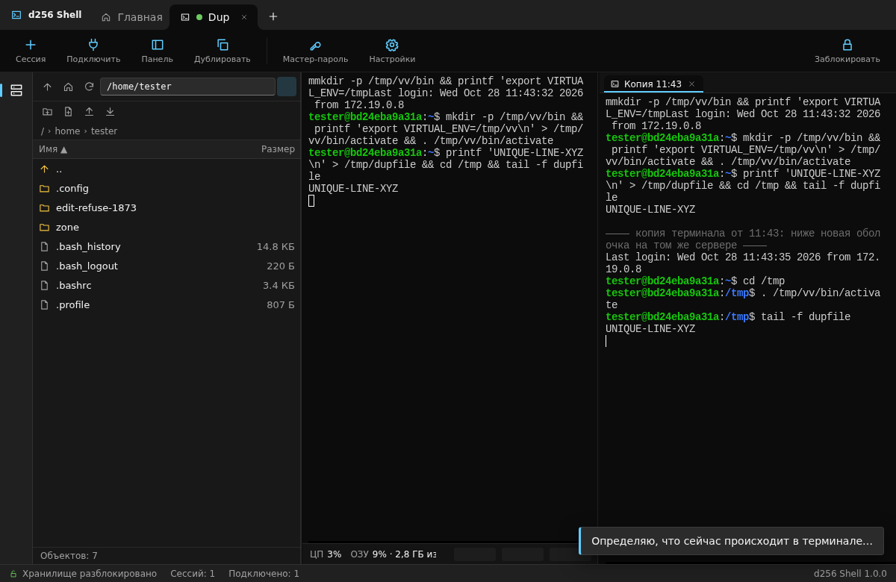
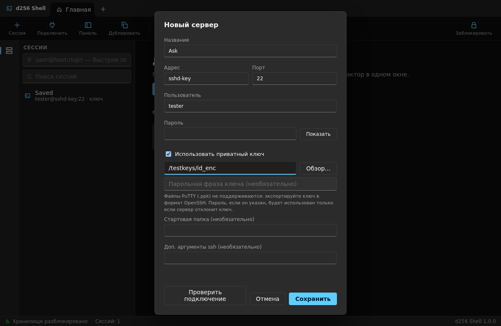
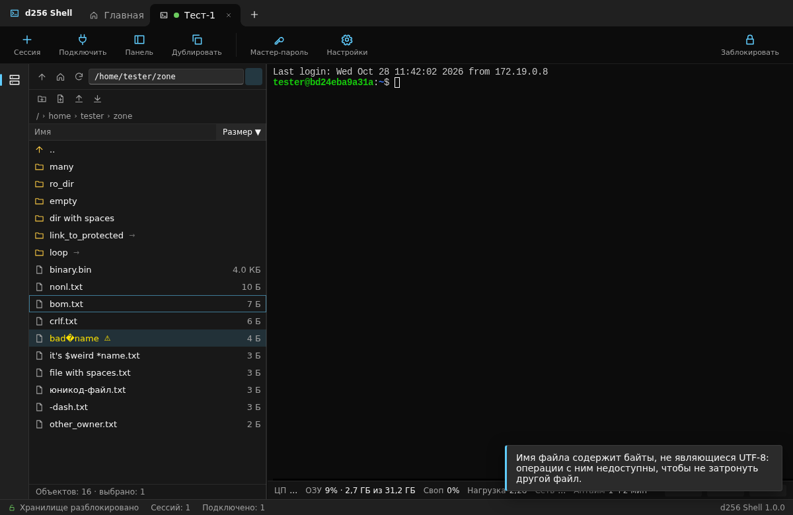
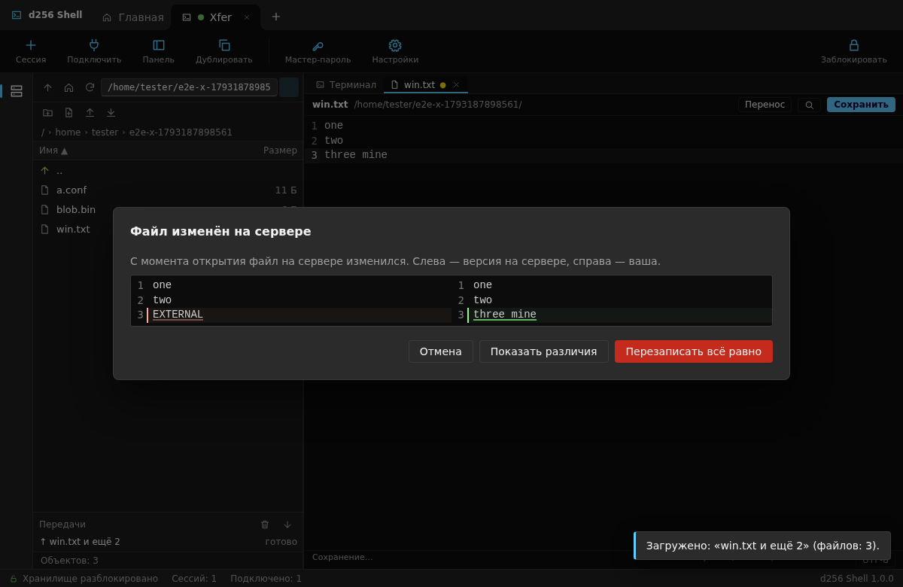
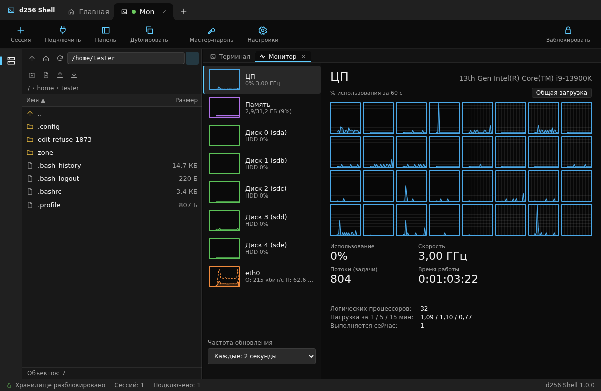

<div align="center">


# d256 Shell

**Портативный SSH-клиент для Windows и Linux**
терминал · файловый проводник SFTP · редактор · монитор сервера


</div>

---

d256 Shell объединяет всё, что нужно для работы с серверами, в одном окне в стиле Windows Terminal с расположением панелей как в MobaXterm:
слева дерево файлов сервера, справа терминал, внизу живая статистика нагрузки. Работает без установки, все данные лежат рядом с программой
в папке `data` и защищены мастер-паролем.

<div align="center">

</div>

## Возможности

### Терминал
- Настоящий системный `ssh` в псевдоконсоли (ConPTY / PTY), отрисовка в xterm.js с WebGL.
- Пароль подставляется автоматически через `SSH_ASKPASS`, без ввода и без попадания в командную строку. Неверный пароль пробуется **ровно один раз**.
- 2FA и любые другие вопросы сервера показываются в диалоге.
- Вставка с предупреждением о многострочном тексте, поиск по выводу, ссылки, масштаб шрифта, вкладки, цветовые схемы.
- **Дублирование терминала** (`Ctrl+Shift+D`): справа открывается вторая живая оболочка, в которую повторяются папка, виртуальное окружение (venv/conda),
  вход через `su` и запущенная программа (btop, `tail -f` …). Команды перед вводом показываются и подтверждаются.

### Вход по ключу и паролю
- Пароли хранятся в зашифрованном хранилище (Argon2id + XChaCha20-Poly1305).
- Вход по приватному ключу (ed25519, RSA, ECDSA; OpenSSH и PEM) с необязательной парольной фразой.

<div align="center"></div>

### Файловый проводник (SFTP)
- Список с виртуализацией (10 000+ файлов), строка «..», хлебные крошки, сортировка, скрытые файлы.
- Создать, переименовать, копировать, вырезать, вставить, удалить (с подсчётом объектов), права доступа (в т. ч. рекурсивно), свойства.
- Загрузка и скачивание файлов и папок через очередь передач: прогресс, скорость, отмена, повтор, вопросы о конфликтах.
- Безопасная запись: временный файл → проверка размера → замена; при обрыве оригинал остаётся нетронутым.
- Drag-and-drop: из Проводника в панель, внутри панели (перенос), из панели наружу.

<div align="center"></div>

### Встроенный редактор
- CodeMirror 6: подсветка синтаксиса, поиск и замена, переход к строке. `Ctrl+S` сохраняет прямо на сервер.
- Сохраняет BOM, окончания строк (LF/CRLF) и отсутствие перевода строки в конце байт в байт.
- Любые кодировки (Windows-1251, KOI8-R, UTF-16, Shift_JIS, GBK …): автоопределение, ручной выбор, сохранение в выбранной кодировке (конвертация). Символы, которых нет в кодировке, не теряются: сохранение откажет.
- Если файл изменился на сервере, показываются различия и предлагается выбор.

<div align="center"></div>

### Монитор сервера
Строка под терминалом (ЦП, ОЗУ, своп, нагрузка, сеть, аптайм и мини-графики) и подробная вкладка с графиками, нагрузкой по ядрам и по дискам.
Данные читаются из `/proc` по SFTP: **на сервере не выполняется ни одной команды.**

<div align="center"></div>

## Безопасность

| | |
|---|---|
| Ключи хостов | Проверяются всегда. Изменённый ключ означает отказ, замена только явным двойным подтверждением. |
| Пароли | Никогда не попадают в логи, аргументы `ssh` и переменные окружения (передаётся только одноразовый токен askpass). |
| Сервер | Программа не выполняет служебных команд и `sudo`. Всё идёт через SFTP или интерактивный shell, который открыли вы. |
| Сеть | Никаких запросов, кроме SSH к вашим серверам: нет телеметрии и автообновлений. |
| Зависимости | Только crates.io и npm, закреплённые версии, `cargo audit`, `cargo deny`, `npm audit` без замечаний. |
| Интерфейс | Полностью встроен в программу, без CDN и удалённых шрифтов, строгий CSP. |

## Установка

Готовые сборки лежат в [Releases](../../releases).

### Windows 10 / 11 (x64)
1. Распакуйте `d256Shell.zip` в любую папку с правом записи.
2. Запустите `d256Shell.exe`. Нужны WebView2 (есть в Windows 11) и клиент OpenSSH (`Параметры → Дополнительные компоненты`).
3. Сверьте SHA-256 с `SHA256SUMS-windows.txt`.

### Ubuntu / Debian
```bash
sudo apt install ./d256shell_1.0.1_amd64.deb
```

### Arch Linux
Положите `PKGBUILD`, `d256shell-1.0.1-linux-x86_64.tar.gz`, `d256shell.desktop` и `COPYRIGHT` в одну папку:
```bash
makepkg -si
```

### Портативно (любой Linux)
```bash
tar xzf d256shell-1.0.1-linux-x86_64.tar.gz && ./d256shell/d256shell
```

Нужны WebKitGTK 4.1, GTK 3 и OpenSSH. Бинарник собран на Ubuntu 22.04 (glibc ≥ 2.34) и проверен установкой в чистые Ubuntu 22.04, 24.04 и Arch.

> **Где хранятся данные.** Если рядом с программой есть папка `data`, она и используется (портативный режим, весь профиль переносится копированием).
> У пакета Linux данные лежат в `~/.local/share/d256shell`. Другую папку задаёт `D256SHELL_DATA_DIR`.

## Сборка из исходников

Всё собирается и тестируется в Docker, на хосте ничего ставить не нужно.

```bash
cd .devcontainer
docker compose up -d --build                         # dev-контейнер и тестовые sshd (порты 2221–2226)
docker compose exec dev bash scripts/check-all.sh    # линт, тесты, e2e, аудит зависимостей
docker compose exec dev bash scripts/make-dist.sh    # Windows: d256Shell.exe и zip
docker compose --profile linux run --rm linux bash scripts/build-linux.sh   # Linux: tar.gz, deb, PKGBUILD
```

Структура: `crates/core` (вся логика), `crates/devbridge` (HTTP-мост для e2e), `src-tauri` (окно и команды), `ui` (TypeScript + Vite),
`e2e` (Playwright), `test-server` (образ тестового sshd), `packaging` (Linux), `scripts`.

Тесты запускаются **только** против собственных тестовых серверов в контейнерах, никогда против реальных.
Подробности и принятые решения: [NOTES.md](NOTES.md), зависимости: [DEPENDENCIES.md](DEPENDENCIES.md).

## Версии и обновления

Номер версии `МАЖОР.МИНОР.ПАТЧ` ([правила](VERSIONING.md)): патч — исправления, минор — новые функции без потери совместимости, мажор — несовместимые изменения. История — в [CHANGELOG.md](CHANGELOG.md). Релиз выпускается тегом `v<версия>`: GitHub Actions собирает пакеты для Windows и Linux и прикрепляет их к странице Releases.

## Известные ограничения
- Файлы ключей PuTTY (`.ppk`) не поддерживаются: экспортируйте в формат OpenSSH.
- Монитор и дублирование терминала требуют Linux-сервер с SFTP; на OpenWrt нужен пакет `openssh-sftp-server`.
- Копирование между разными серверами пока недоступно; нет SSH-агента и аппаратных ключей.
- Исполняемые файлы не подписаны цифровой подписью, Windows SmartScreen может показать предупреждение.

## Автор и права

© 2026 **dest1256**. Приватное программное обеспечение: лицензия не предоставляется, все права защищены (см. [COPYRIGHT](COPYRIGHT)). Репозиторий и сборки предназначены только для доверенных лиц, копировать, изменять и распространять их без разрешения автора нельзя.
Сторонние библиотеки распространяются на условиях своих лицензий (MIT, Apache-2.0 и др.), их полный список есть в программе: `Настройки → О программе → Лицензии библиотек`.
